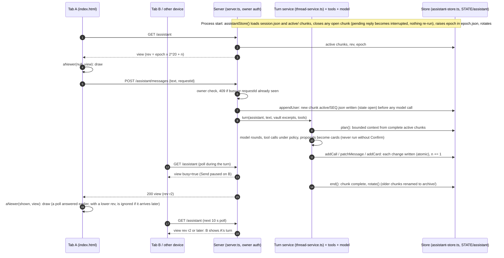
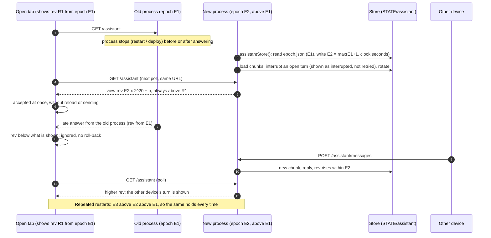
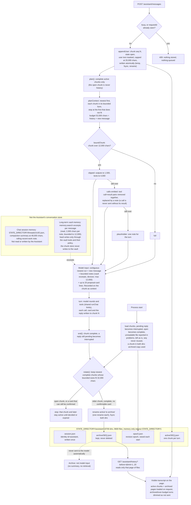

# The Assistant: how it works (diagrams)

This page shows how the Assistant works as implemented, in two diagrams: how the page and the server stay in sync (including across restarts), and how the rolling conversation is stored and turned into model context. The full reference (budgets, routes, crash behaviour, tests) is `docs/assistant.md`. Both diagrams come from the code at the commit that added this page, and name the source files they rely on.

Source files:

- `src/assistant-store.ts`: the chunk store, rotation, the archive, crash recovery, and the restart-safe revision (`REV_STRIDE`, `epoch.json`).
- `src/assistant-context.ts`: the context bound (`boundChunk`, `planContext`) and the budgets.
- `src/server.ts`: the routes (`/assistant`, `/assistant/history`, `/assistant/messages`), `assistantView()`, `prepare()` (vault excerpts, devices, tools), and the wiring of the Assistant's `threadService`.
- `src/thread-service.ts`: the shared turn code (model rounds, tools, proposal cards, deadlines). The Assistant uses it with `compact: false` and no rolling recent-work note.
- `src/web/index.html`: the Assistant section of the page (`aload`, `asend`, `drawAssistant`, the 10-second poller) and the `<assistant-order>` block (`aNewer`), which decides whether an answer may replace what is drawn.

## 1. Page and server: loading, sending, polling, restarts

### Endpoints

All are owner only (403 for anyone else, before anything is read or changed). POSTs are also subject to the existing cross-site refusal.

| Endpoint | Used by the page | Returns |
|---|---|---|
| `GET /assistant` | on load, every 10 s while the Assistant is showing and the page is visible (`makePoller`), after an unanswered send, after a card is confirmed or cancelled | `{ assistant: view }` |
| `POST /assistant/messages {text, requestId}` | Send | `{ assistant: view }` after the turn (200, or 502 if the model failed); 409 with the view if busy or a repeat of a send already started |
| `GET /assistant/history?before=<seq>&limit=<1-20>` | "Load earlier messages" (10 at a time) | `{ chunks, more }`: archived chunks only, never put in the model's context |

The view (`assistantView()` in `src/server.ts`) contains `session` (always `id: "assistant"`), `busy`, `rev`, `epoch`, the active `chunks`, `archivedChunks`, `next` (what the next turn would be sent), `budgets`, `persisted` and `problems`.

### Revisions across restarts

The page draws an answer only if `aNewer(shown, incoming)` holds, that is, if the answer's `rev` is not below the `rev` it shows. So a slow poll, a poll overtaken by a send's answer, or a late answer never rolls the conversation back. `aload` also drops a poll answer if a later poll's answer has already been drawn (`aloadSeq`/`ashownSeq`). Before this fix, `rev` was a counter in memory that started at 1 in every process. After a restart or deploy, an open tab holding, say, `rev` 400 ignored every answer from the new process until that process had made 400 changes. The tab looked frozen and only a reload fixed it.

Now `rev = epoch × 2^20 + n` (`src/assistant-store.ts`):

- `n` counts changes in this process, starting at 1. Every stored change adds one: a new turn, a reply or tool call, a card state change, a rotation.
- `epoch` is raised every time the store is opened (each process start), to `max(stored epoch + 1, wall clock in whole seconds)`. It is written to `<state>/assistant/epoch.json` before the process serves any revision from it. If more than 2^20 changes happen in one process, the epoch is raised again.

So every revision from a later process is above every revision from an earlier one. A delayed answer from a process that has since stopped still compares lower and is ignored. The comparison is the same `>=` the page already used, so:

- **Tabs that were already open at the deploy** (still running the PR #83 page code, `rev < aview.rev` means ignore) resume on their next poll with no reload and no send, because the new process's first `rev` (about 1.9 × 10^15) is far above any plain counter the old process reached. `test/assistant-restart.test.ts` checks this against the old rule.
- **Tabs with the new page** use `aNewer`, the same order, and also apply it to the answer of their own send, so a late send answer can never roll back a newer poll.
- **Stored data is not touched.** No chunk, the session identity or the archive is rewritten, reset or deleted. `epoch.json` holds only a number. A missing `epoch.json` (a store written before this change) is normal. An unreadable one is reported in `problems` and replaced by a new epoch taken from the clock.

What this does not do (unchanged from PR #83):

- An unanswered send is never resent. The page says "ORBIT did not answer. Your message may or may not have been received" and reloads. A send cut off by the restart is either stored (and shown as interrupted after the restart) or was never received. `requestId` lets the server refuse a browser's silent repeat of a send that started a turn.
- A turn in progress at a restart is not resumed or re-run. Its reply is marked `interrupted`.
- Approval controls do not change. Proposal cards are confirmed only through `POST /chat/proposals/:id/confirm`, single use. A card whose proposal was lost in the restart shows `expired`.

## 2. The rolling memory: storage, context, archive

How to read it, using what the code does:

- **Visible transcript, bounded model context, chat session memory and vault memory are four separate things.** The page shows every active chunk and any archived pages the reader loads. The model is sent only the newest complete active chunks that fit, each in its bounded form, plus the new message (`planContext`, at most 52,000 characters of conversation). Chat threads (`<state>/threads/`, with compaction and the recent-work note) are a separate store. The Assistant neither reads nor refreshes them. The vault is searched for each message, the same way chat does it (`prepare()`), and its excerpts arrive as bounded reference notes. Nothing from the archive is ever added to the model input automatically. There is no summarization of the archive and no retrieval from it.
- **Durable writes.** Every chunk change is a synchronous read, modify and write of a copy, written atomically before it replaces the copy in memory. Archiving is one `rename` per chunk, so a chunk is always in exactly one directory, even after a crash in the middle of a rotation.
- **What blocks rotation.** Rotation stops at an open chunk (a turn in progress) and at a chunk with a proposal card that can still be confirmed (the proposal is present and has not expired). Meanwhile the active window can exceed 32,000 characters, but the 52,000 prompt bound still holds, because `planContext` leaves out what does not fit.
- **Recovery.** At start the store closes an open chunk (its pending reply becomes `interrupted`, and nothing is re-run). It reports unreadable files without touching them, never reuses their sequence numbers, raises the revision epoch and then rotates.

## Manual two-tab restart acceptance (not performed by the job that wrote this)

On a deployed ORBIT, as the owner, with the Assistant tab showing (the poller runs only while the tab is visible):

1. Open `/` in two browser tabs (or a tab and a phone) and send a few messages from tab 1 so both show them.
2. Restart ORBIT (`systemctl restart` or a deploy). Do not reload either tab, and do not send.
3. From a third device (or after the restart, from tab 2), send "after restart 1".
4. Within about 10 seconds, both untouched tabs show "after restart 1". Check that nothing above it disappeared or was duplicated.
5. Repeat steps 2 to 4 at least twice more ("after restart 2", "after restart 3").
6. Restart while a reply is in progress: after the restart, every tab shows that reply as interrupted, Send works again, and the message was not answered twice.
7. Check `<state>/assistant/epoch.json` exists and its `epoch` grew with each restart. Check `session.json` is unchanged and no chunk file was removed.
8. Open `/#chat`: threads behave as before.

## Limits

- Ordering between processes relies on the persisted epoch (or, without a state directory, on the wall clock). If `epoch.json` is lost and the clock is also set back, a new process can start below an old one. The page then ignores the new process until a reload. Without a state directory the conversation itself is lost at a restart anyway.
- The page ignores a lower revision for good. If an operator restores `<state>/assistant/` from a backup together with an older `epoch.json`, open tabs need a reload. Restoring a backup is not something ORBIT does.
- Two processes on one state directory at once are still not supported.
