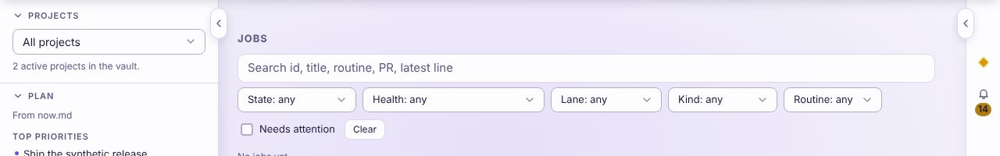
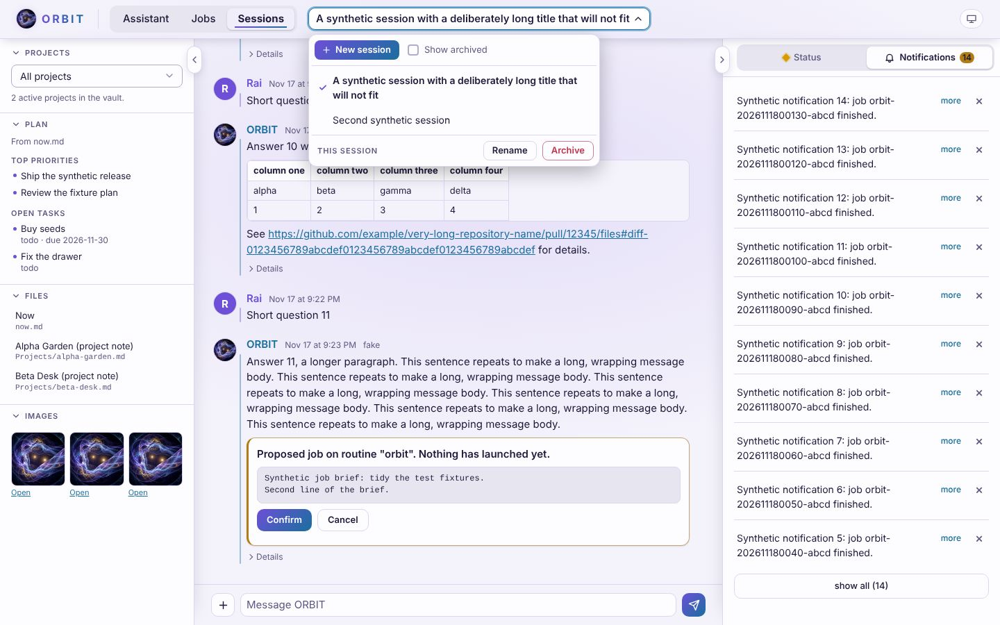
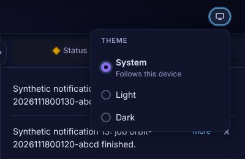
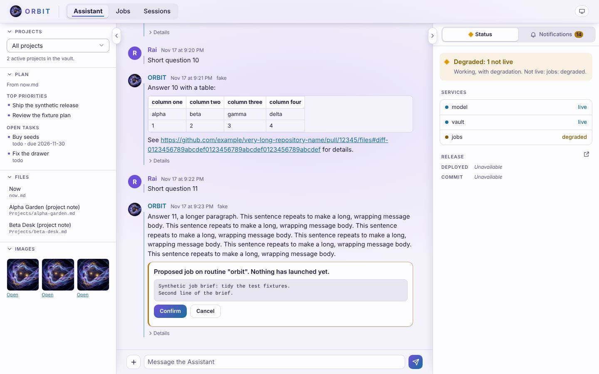
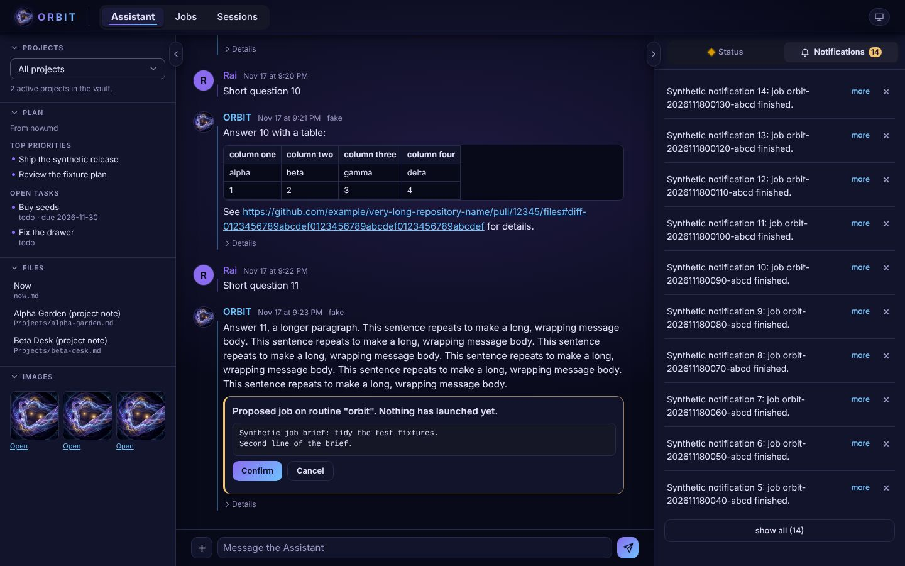
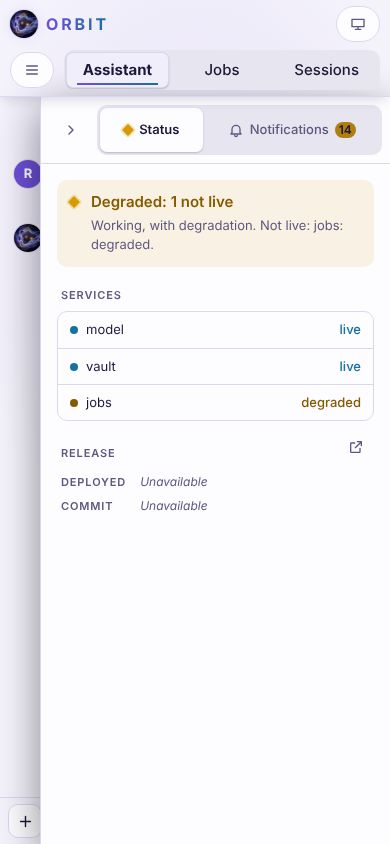

# The web page's component library (November 2026)

Rai asked for the dropdown arrows, the menu and the right side panel (status and notifications) to be fixed by bringing
in a well-maintained UI library instead of patching CSS one issue at a time. This note covers the evaluation, what was
picked, how it is wired in, what changed on screen, and what was verified. The design system it sits on (tokens, themes,
buttons) is in [design-system.md](design-system.md) and is unchanged except where this note says so.

## The problems

1. **Dropdown arrow.** The Projects selector (left sidebar) and the Jobs filters were native `<select>`s with ORBIT's own
   padding (`4px 8px`). The browser drew its arrow flush against the right edge, with the text running up to it.
2. **The menu looked off.** The session menu mixed looks: a large gradient New session button, a native checkbox, the
   open session marked by a tinted box with a 3px bar on desktop and a bordered box on phones, 40px rows, and Rename and
   Archive in a separate style. The theme menu was a second, slightly different card.
3. **The side panel was noisy.** The Status view led with the release (Deployed, Commit) and a bordered link button
   floating beside it, then the overall status in a card with a coloured edge, then the services. Every notification was
   a card with a gold edge and a gold tint, so gold (which means "waiting on Rai") was on every row.

## Evaluation

The page is plain HTML, CSS and JavaScript served by the Node server, with no framework and no build step, and it makes
no third-party request (a test checks there is no web font or font service). The library had to fit that.

| Candidate | Fits? | Why |
|---|---|---|
| shadcn/ui | No | React components (copied into a React app), built on Radix and Tailwind. Needs React and a bundler. |
| Radix Primitives | No | React only. |
| Park UI | No | Styled Ark UI for React, Solid or Vue, plus Panda CSS: a framework and a build. |
| Ark UI | No | React, Solid, Vue or Svelte. Its state machines (Zag.js) have no supported plain-JS adapter. |
| Basecoat (shadcn/ui for plain HTML) | No | Closest in look, but its ready-made CSS is a full Tailwind build (about 235 KB) with Tailwind's global reset, and its unprefixed tokens (`--card`, `--border`, `--text-sm`, `--radius-sm`, `--font-sans`) collide with ORBIT's own, with different meanings (ORBIT's `--border` is a whole border, Basecoat's a colour). Using it properly needs Tailwind as a build step. |
| Shoelace (web components) | No | Framework-free, but its select and menus are shadow-DOM components: they would replace the native `<select>` (and its phone picker) and the roles, names and keyboard behaviour the page's tests and docs pin down, and it is far heavier. |
| **Pico CSS** | **Yes** | Plain CSS, no JavaScript, no framework. Styles semantic HTML (native select, checkbox, radio), so the markup, roles and behaviour stay as they are. Every variable is prefixed (`--pico-*`), so nothing collides with ORBIT's tokens. It picks its theme from `data-theme` on `<html>` exactly as ORBIT does. It can be scoped to a class (`.pico`). MIT, mature, and small once built down. |

## What was built

- **Pico CSS 2.1.1, vendored** in `src/web/vendor/pico/` (files, licence, hash and the rebuild recipe in its
  [README](../src/web/vendor/pico/README.md)), served by ORBIT at `/vendor/pico.orbit.min.css`. Never from a CDN.
- **A scoped build.** Pico's ready-made "conditional" file still sets the page's root font size (up to 131% on wide
  screens, which changes every `rem`), `overflow-wrap` and fonts, and has page layout rules. So ORBIT builds it from Pico's
  own Sass with `.pico` as the parent selector and only the modules it uses: the theme variables, form basics, checkbox
  and radio, card, dropdown, nav, loading and reduced motion. Buttons, typography, the document, landmarks, containers and
  grid are off (ORBIT has its own). 40,777 bytes, about 6 KB gzipped. The build is a one-off vendoring step
  (`src/web/vendor/pico/build.sh`, pinned versions); ORBIT itself still has no build step.
- **Its own cascade layer.** The page's stylesheet begins with `@layer pico;` and imports the file into that layer, so
  every ORBIT rule wins over Pico whatever its specificity: Pico is the base and ORBIT's tokens and rules sit on top.
- **A token bridge.** One `.pico { … }` rule maps Pico's variables onto ORBIT's tokens (surfaces, text, accent, borders,
  focus halo, radii, spacing, type, the dropdown and card colours). The library therefore follows Light, Dark and System
  with no theme-specific rules, and the dark values are still written only in ORBIT's two theme blocks.
- **Where it applies** (`class="pico"`): the Projects section of the left sidebar, the Jobs filter row, the session menu,
  the theme menu and the side panel. Nothing else.

## What changed on screen

### Dropdowns

Pico's select: no native arrow (`appearance: none`), Pico's chevron 10px in from the right edge, and the text padded to
stop before it (12px on the left, 36px on the right). Same control height as before, ORBIT's border, card surface and
focus look (accent border, halo and ring). The Projects selector and all five Jobs filters use it; the Jobs filters now sit
in a wrapping row with gaps instead of touching. The Show archived and Needs attention checkboxes and the theme radios are
Pico's too, in ORBIT's colours.

### Menus

The session menu and the theme menu are one component: the same card (Pico's dropdown variables, ORBIT's tokens), groups
split by hairlines, a small-capitals group label ("This session", "Theme"), plain rows that tint on hover, and the current
choice marked the same way in both: a check in the accent colour (the session) or the filled radio (the theme), plus bold
text. No bar, no box, no border on any row, on any width (phones used to keep a bordered box). Rows are 36px (44px on
touch screens). New session is a compact primary button with a plus icon, Show archived sits beside it, and Rename and
Archive (secondary and destructive) sit on the This session row. A session that needs attention shows a small gold dot at
the end of its row (its text still says how many); before, it was a gold bar.

### Side panel

The head (the collapse button and the Status and Notifications tabs), the rail, resizing, keyboard behaviour and every
other feature are unchanged. The views are simpler:

- **Status:** the overall status first (the level's dot, its label in bold and its detail, on a quiet tint of the level's
  colour, no edge), then any read error, then **Services** as one list (a dot, the name on the left, the state on the
  right; the text is still "model: live"), then **Release** with the /status link as a quiet icon at the right of its
  label, and Deployed and Commit under it. Before, the release led the view.
- **Notifications:** one flat list. Each note is a row with a hairline above the next: its first line, then "more" and
  the dismiss button, both quiet until hovered. No gold edge or tint on every row; gold stays for the count in the tab.
  "Show all (n)" is a full-width secondary button at the end.

## What did not change

Markup ids, roles, names and states; all the script behaviour (opening, closing and placing the menus, keyboard handling,
focus return, the side panel's tabs, rail, resize and kept state, receipts for listed notes, dismissing, "more" and
"show all", the status reads and their error states); the header; the left sidebar other than the Projects selector; the
conversation, composer and Jobs list.

## Tests

- `test/ui-library.test.ts` (new): the vendored file's hash, version, licence and build recipe; the import (first, in the
  `pico` layer, ORBIT's own address, no CDN) and the four `.pico` areas; every rule in the build is under `.pico` except
  Pico's variables and `color-scheme`; in Chromium, Light and Dark, **every computed style outside a `.pico` element is
  identical with and without the library** (only the size of a box that holds a `.pico` element may follow it), and the
  page requests nothing from elsewhere; the selects' chevron, its 10px inset and the text's padding (Projects and Jobs,
  both themes); the two menus share the card, group label and current-row marking, with Pico's checkbox and radio; the
  side panel's flat lists, the services' name and state and the group labels.
- `test/server.test.ts`: ORBIT serves the vendored file (type, `nosniff`, the exact bytes) and nothing else under
  `/vendor/`.
- Updated for the intended changes: the Status view's order (`deploy-info`, `header-panels`, `side-panel-browser`,
  `web-ui`), the `class="pico"` on the menus and panel (`header-panels`, `themes-browser`), the menu rows (36px, a check
  instead of a bar, the same rows on phones: `side-panel-browser`, `sidebar-browser`, `sessions-picker-browser`). The test
  servers that serve the page now also serve the vendored file (`test/helpers/web-assets.ts`).

**Not verified:** a real screen reader, real phones and tablets (Chromium emulation only), and WebKit/Safari and Firefox.
`@import … layer()` needs Safari 15.4+, Firefox 97+ or Chrome 99+; an older browser reads `layer(pico)` as a media query it
does not know and skips the import, so it shows the native controls with ORBIT's styles (as before), never Pico unlayered.
